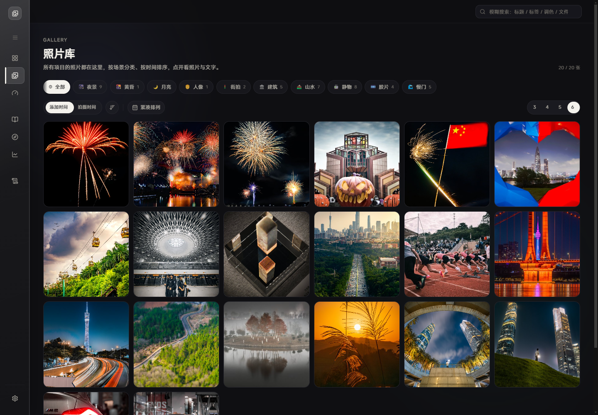
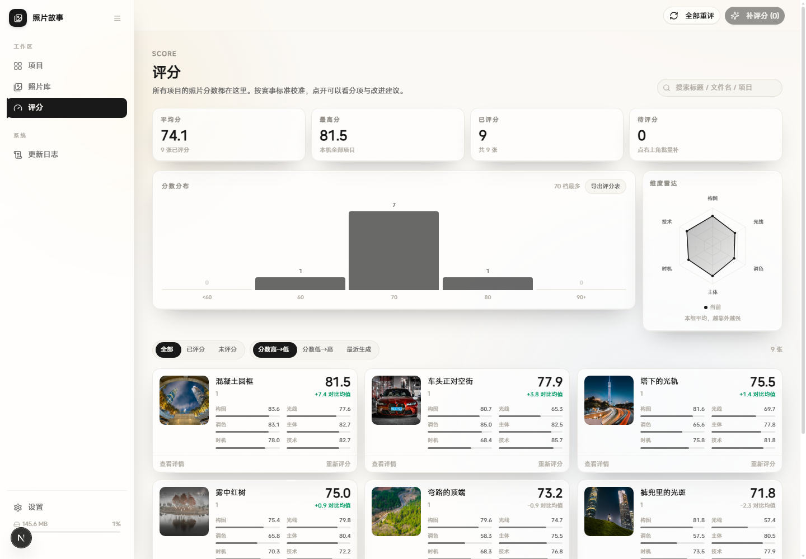
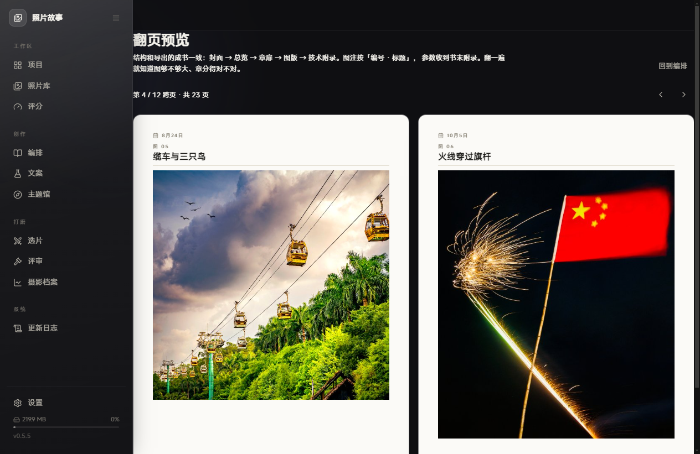
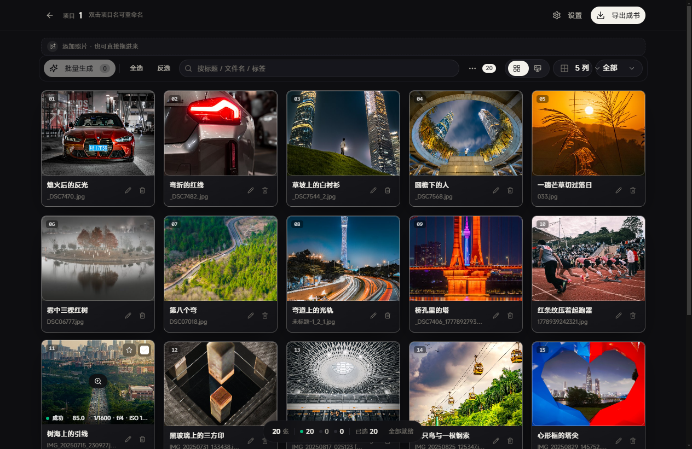

# 照片故事 · Photo Story

把一组照片，写成一册有标题、有故事、有拍摄手法的书 —— 而且能直接拿去打印。

上传照片 → AI 看图写作 → 自动评分挑片 → 编排章节 → 导出 Word / PPT / PDF，或先用内置的「翻页预览」在软件里翻一遍再导。



## 它到底做了什么

| 能力 | 说明 |
|---|---|
| AI 看图写作 | 给每张照片生成标题、故事、拍摄手法、标签、氛围；同一张图还能一次要四种写法（文学随笔 / 四字硬句 / 电影纪实 / 隐喻散文诗）后挑一条 |
| 评分 | 六维打分（构图 / 光线 / 调色 / 时机 / 主体 / 技术）+ 总分，模型主观与像素客观混合；先判场景（白天 / 暗调 / 高调 / 逆光…）再评分，夜景烟花不会被误判成「欠曝」 |
| 挑片 | 手动勾选、按分数选、智能精选（高分 + 题材分散）、两两淘汰赛排座次 |
| 编排 | 章节分组、拖拽排序、章题记、呼吸页、自动分章、约页数 |
| 排版导出 | 按真实摄影书规则排：图顶对齐、图注左对齐贴图、参数进书末技术附录、章节≥4 张才占扉页、总览页网格；输出 Word / PPT / PDF，打印级 |
| 翻页预览 | 用与导出完全相同的结构在软件里翻页检查，含装订成帖的页数提醒（4 的倍数） |
| 不丢东西 | 删除先进回收站，可恢复；撤销不再复制原图 |

<table>
<tr>
<td></td>
<td></td>
</tr>
<tr>
<td></td>
<td></td>
</tr>
</table>

## 环境要求

- Node.js >= 20.11（开发用；打包后的 exe 自带运行时）
- Windows 10 / 11（Electron 桌面版；纯浏览器跑 `npm run dev` 也行）

## 快速开始

```bash
npm install
npm run dev          # 浏览器开发，http://127.0.0.1:3939
npm run typecheck    # 类型检查
npm run electron:dev # 桌面版开发（带热更新）
```

## 配置 AI

应用「设置 → AI」里填 **Base URL / 模型 / API Key**，或用环境变量兜底：

```bash
cp .env.example .env.local    # 然后填 OPENAI_API_KEY
```

默认按 DeepSeek 配（`https://api.deepseek.com` / `deepseek-flash`，支持图片输入且便宜）。任何兼容 OpenAI Chat Completions 协议、支持 `image_url` 的模型都能用。

> 本仓库**不包含任何 API Key**。你填的 Key 存在本机 `data/ai-config.json`（桌面版在 `%APPDATA%\photo-story\data\`），不会上传。

## 打包

```bash
npm run electron:build   # next build → 复制 standalone → electron-builder 出 NSIS 安装包
```

产物在 `dist-electron/`，并自动归档到 `安装包/<版本>/`（该目录不进仓库）。

## 目录

```
src/app            页面与 API 路由（Next.js App Router）
src/components     UI 与工作台组件（照片网格、预览、编辑器、导出对话框…）
src/config         常量、提示词、Word 排版参数、模块说明
src/lib            db（IndexedDB）、image、ai、export（docx/pptx/pdf）、score、book
src/types          领域类型
electron/          主进程与 preload（窗口、菜单、IPC、文件保存）
scripts/           构建与发版脚本
docs/screenshots   README 用的截图
```

## 技术栈

Next.js 15（App Router，`output: 'standalone'`）· React 19 · TypeScript strict · Tailwind v4 · Radix + 自研 UI · docx / pptxgenjs · IndexedDB（idb）· Electron 33。

## 版本与更新日志

当前版本 **0.5.6**。每个版本都有一份中文更新日志，见仓库根目录 `更新日志_<版本>.md`；应用内「更新日志」页也能看。

## 已知限制

- 本地评分是**自写的像素统计**（曝光分位、对比、饱和度、边缘能量），不是 IQA-PyTorch 那类深度模型 —— 要内置 PyTorch 会让安装包多出几百 MB。
- 亚克力窗口材质需要 Windows 11 22H2+。
- 数据存在 IndexedDB：清理浏览器数据 / 重装系统前请用内置的备份或 `.zpgs` 打包导出。

##  License

[MIT](LICENSE)
